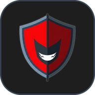

# 🛡️ HardcoreBlocker

<p align="center">
  
</p>

<p align="center">
  <strong>The Ultimate 100% Offline, Privacy-First Spam Call & Phishing SMS Shield for Android</strong><br>
  <em>Language: 🇬🇧 <strong>English</strong> | 🇮🇩 <a href="README.id.md">Bahasa Indonesia</a></em>
</p>

<p align="center">
  
  
  
  
  
</p>

---

## 🌟 Why HardcoreBlocker?

Mainstream commercial call-blocking apps upload your entire address book, call logs, and SMS messages to remote cloud servers under the guise of "community analytics". Your family's private numbers, business contacts, and personal conversations end up monetized and exposed to data breaches.

**HardcoreBlocker was built on zero-compromise privacy principles:**
- 🚫 **Zero Internet Permission**: The `android.permission.INTERNET` privilege is **completely omitted** from `AndroidManifest.xml`. It is technically impossible for any data to leave your device.
- ⚡ **0-Millisecond Termination**: Hooks directly into Android's native `CallScreeningService` Telecom subsystem, rejecting unwanted callers before your phone vibrates or rings.
- 💬 **Intelligent SMS Quarantine**: Isolates scam SMS (fake courier APK drops, fraudulent fines, predatory loan traps, phishing URLs) into a sandboxed quarantine inbox.
- 🌐 **Full Bilingual Support**: Instant seamless switching between **🇬🇧 English** and **🇮🇩 Bahasa Indonesia** directly from Settings without restarting the app.

---

## 🚀 Key Features

### 1. 🛡️ Dual Defense Modes
- **Hardcore Mode (Contacts Only)**: Only numbers saved in your phonebook are allowed to reach you. Every unknown or foreign number is rejected instantly. Extremely effective against aggressive telemarketers, robo-callers, and unknown stalkers.
- **Smart Mode (Rule-Based)**: Blocks incoming calls and messages matching your custom criteria (Exact Blacklist, Area/Country Prefix, or SMS Content Keywords).

### 2. 📋 Granular Blocking Rules
- **Exact Number**: Block specific offenders (e.g., `+12025550199` or `081299998888`).
- **Prefix Matching**: Silence unwanted countries (e.g., `+60`, `+1`, `+44`) or spam area codes (e.g., `021`, `140`).
- **Keyword Filtering**: Intercept SMS based on spam triggers such as *"free loan"*, *"lottery winner"*, *"click here"*, *"delivery issue"*.
- **Regex Patterns**: Full Regular Expression syntax support for sophisticated pattern matching.

### 3. 🧪 On-Device Rule Simulator
Simulate any hypothetical phone number or SMS body in real-time to preview whether it will be passed, silenced, or quarantined before activating rules.

### 4. 💬 Safe SMS Quarantine & Inbox
- **Malicious Link & APK Detection**: Identifies risky patterns (`.apk`, `bit.ly`, `t.me`, `wa.me`) and neutralizes them inside an isolated quarantine view.
- **1-Tap OTP Extraction**: Automatically detects 4-to-8 digit verification codes with a convenient one-touch copy button.
- **1-Tap Block Sender**: Add any offending sender straight to your blacklist without ever leaving the conversation detail sheet.

### 5. 🌓 Dynamic Adaptive Theming
- **Dark Mode**: True OLED black palette, reducing eye fatigue and preserving battery life.
- **Light Mode**: High-contrast, clean corporate aesthetic with modern Material 3 accents.
- **Follow System**: Seamlessly adapts to your Android operating system's theme schedule.

### 6. 🔄 Local Encrypted Backup & Restore
Export and import your entire rule dictionary and settings via encrypted JSON files or clipboard text. Zero cloud dependency.

---

## 🛠️ Architecture & Tech Stack

```
HardcoreBlocker
├── app/
│   ├── src/main/java/com/hardcoreblocker/app/
│   │   ├── data/
│   │   │   ├── model/         # BlockRule, BlockedLog, BlockSettings, SmsMessageItem
│   │   │   └── repository/    # BlockRepository (Offline DB & Encrypted Prefs)
│   │   ├── service/           # HardcoreCallScreeningService & HardcoreSmsReceiver
│   │   ├── ui/
│   │   │   ├── components/    # CommonComponents, Dialogs, BottomSheets
│   │   │   ├── i18n/          # Centralized AppStrings (English & Indonesian)
│   │   │   ├── screens/       # Splash, Onboarding, Dashboard, Inbox, Rules, Logs, Settings
│   │   │   ├── theme/         # Color tokens, Typography, Theme provider
│   │   │   └── viewmodel/     # MainViewModel (MVI/MVVM with StateFlow)
│   │   ├── HardcoreBlockerApp.kt
│   │   └── MainActivity.kt
```

- **Language**: Kotlin 2.0
- **UI Toolkit**: Jetpack Compose (Declarative UI) & Material 3
- **State Management**: Kotlin Coroutines & `StateFlow`
- **OS Subsystem**: `android.telecom.CallScreeningService`
- **Local Persistence**: Room SQLite Database & Android SharedPreferences
- **Independence**: Zero external analytics SDKs, No Firebase, No Google Mobile Ads, No trackers.

---

## 📲 Build & Installation Guide

### Prerequisites:
- **Android Studio**: Ladybug / Koala (or newer)
- **JDK**: Version 17 or higher
- **Android SDK**: Min SDK 28 (Android 9.0 Pie) • Target SDK 35 (Android 15)

### Steps to Compile:

1. **Clone the repository**:
   ```powershell
   git clone https://github.com/Zettt416/HardcoreBlockerzp.git
   cd HardcoreBlockerzp
   ```

2. **Build Debug APK**:
   ```powershell
   .\gradlew assembleDebug
   ```
   *Output binary:* `app/build/outputs/apk/debug/app-debug.apk`

3. **Build Optimized Release APK**:
   ```powershell
   .\gradlew assembleRelease
   ```
   *Output binary:* `app/build/outputs/apk/release/app-release.apk`

4. **Install to Connected Device or Emulator**:
   ```powershell
   adb install -r app/build/outputs/apk/release/app-release.apk
   ```

---

## 🔐 Permissions Transparency

HardcoreBlocker requests only the bare minimum Android system permissions necessary for call screening and message classification:

| System Permission | Purpose / Rationale |
|---|---|
| `ROLE_CALL_SCREENING` | Grants OS-level authority to screen incoming calls and drop spam before ringing. |
| `READ_CONTACTS` | Allows on-device verification against your contact book (100% local whitelist, never uploaded). |
| `RECEIVE_SMS` & `READ_SMS` | Intercepts incoming messages to classify spam, extract OTPs, and quarantine malicious links. |
| `POST_NOTIFICATIONS` | Displays optional silent heads-up alerts when an intrusion or scam is thwarted. |

> 🛡️ **Privacy Guarantee:** HardcoreBlocker **does not request the `INTERNET` permission**. Your contacts, messages, and call logs can never leave your device.

---

## 🤝 License & Contributing

Built with dedication to digital privacy and user empowerment.  
Issues and Pull Requests are welcome!

**Copyright © 2026 HardcoreBlocker.**  
Distributed under the [MIT License](LICENSE).
